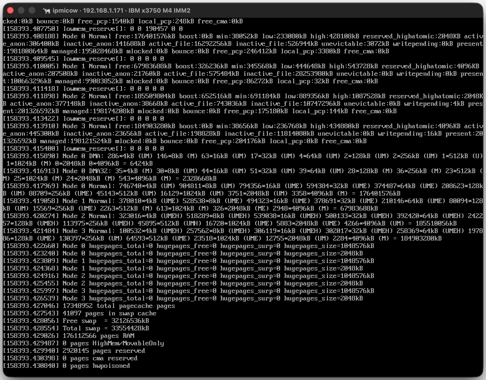
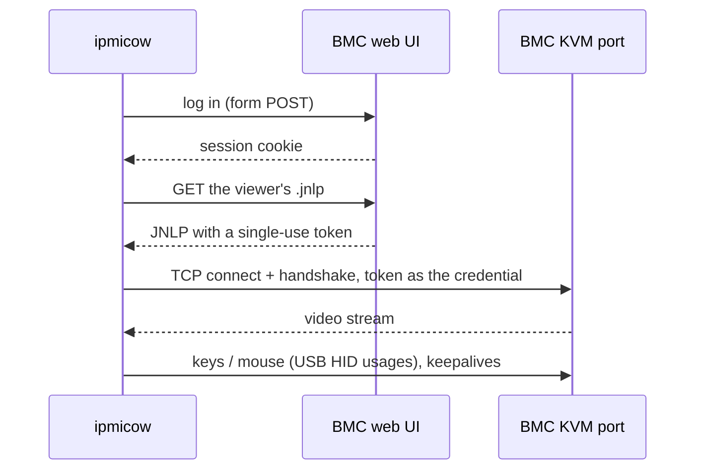

<div align="center">


# ipmicow

**Native consoles for ancient BMCs.**<br>
No JRE. No Web Start. No *"Application Blocked by Java Security"*. Just moo.

[](https://github.com/tbbuck/ipmicow/actions/workflows/ci.yml)
[](LICENSE)

</div>

<p align="center"></p>


## Why

That rack-mounted bargain from 2013 still runs fine, but its remote console is a signed
Java Web Start applet. That means a Java 6-era JRE, a `.jnlp` your browser no longer
knows how to open, a certificate that expired years ago, and a security-exception list
you have to keep editing. All so you can press Del during POST.

ipmicow speaks those consoles' wire protocols directly, in pure Rust, in a small native
window. It logs in to the BMC's web UI to mint a session token, exactly as the Java
button does, then connects and streams. No vendor code is involved.

## Supported hardware

| Family | BMC / viewer | Protocol | Tested on |
|---|---|---|---|
| **Supermicro X9** | ATEN iKVM | RFB-flavoured, raw RGB555 over TCP 5900 | B1SA4-F, BMC firmware 3.19 |
| **IBM IMM2** | Avocent viewer | APCP/BEEF + DVC video over TCP 3900 | System x3750 M4, IMM2 firmware 8.00 |

**Probably works, reports welcome:** other X9-generation Supermicro boards with ATEN
firmware, and other IMM2 machines (x3550 M4, x3650 M4, …). Avocent's DVC stack also sits
behind Dell iDRAC6/7 and Avocent KVM switches, so the decoder is a head start there. Got
something else? See [adding a BMC](docs/adding-a-bmc.md).

| | X9 | IMM2 |
|---|:-:|:-:|
| Live video, follows resolution changes | ✅ | ✅ |
| Keyboard | ✅ | ✅ |
| Mouse (absolute) | ❌ | ✅ |
| Auto-reconnect, POWERED OFF screen | ✅ | ✅ |
| Keys menu: Ctrl-Alt-Del, VT switch, F-keys, Magic SysRq | ❌ | ✅ |
| Sent-keys overlay | ❌ | ✅ |
| Colour depth (7–23-bit) | — | ✅ |
| Reset host USB (re-plug the virtual keyboard/mouse) | ❌ | ✅ |
| Host keyboard LEDs | ❌ | ✅ |
| Virtual media (mount an ISO) | ❌ | ❌ |

## Install

**From a release:** grab a binary for macOS (universal) or Linux (x86_64) from the
[Releases](https://github.com/tbbuck/ipmicow/releases) page. The macOS binary isn't
notarised, so clear the download quarantine once:
`xattr -d com.apple.quarantine ./ipmicow`.

**With Cargo** (Rust 1.87+):

```sh
cargo install ipmicow
# or the latest main:
cargo install --git https://github.com/tbbuck/ipmicow
```

On Linux you'll also need the X11/Wayland and OpenSSL development headers, e.g.
`sudo apt install pkg-config libssl-dev libx11-dev libxkbcommon-dev libwayland-dev`.

## Quick start

```sh
ipmicow 10.0.0.42
```

ipmicow checks which KVM port the BMC has open (3900 → IMM2, 5900 → X9) and uses that
family's factory login (`ADMIN`/`ADMIN` or `USERID`/`PASSW0RD`). If you've changed it
(you have, right?), keep the password out of your shell history:

```sh
export IPMICOW_PASSWORD='…'
ipmicow --user admin 10.0.0.42
```

To skip detection, name the family: `ipmicow x9 <host>` or `ipmicow imm2 <host>`.
`ipmicow --help` covers the rest.

## In the window

- **Every key goes to the host**, Esc included, because BIOS setup, boot menus and RAID
  utilities need it.
- On the IMM2 under macOS, **Cmd is the Windows key**. A lone Cmd tap is never sent, so
  Cmd-Tab won't pop the host's Start menu.
- **Quit** with the close button (or **Cmd-Q** on the IMM2, which releases any held keys
  on the host first).
- **IMM2 menu bar** (macOS):
  - **Keys:** Ctrl-Alt-Del, Alt-PrintScreen, Switch Virtual Console (Ctrl-Alt-F1…F12),
    Send Function Key, Magic SysRq (every x86-relevant command; the destructive ones are
    marked ⚠), Release All Keys, Check Host Keyboard LEDs, Reset Host USB, Show Sent Keys.
  - **Video:** Colour Depth (Automatic, or 7–23-bit).
- **Sent-keys overlay:** the chord the host just received is drawn as keycaps in the
  bottom-right corner, which helps when you're not sure a key made it.
- If the host is off, or the link drops, you get a calm **POWERED OFF** screen and a
  "reconnecting" toast, and video resumes on its own.

`-v` / `--verbose` logs every key and button sent and every control message the BMC sends
back, with timestamps you can line up against the host's own logs.

## How it works



The two families couldn't be more different once connected:

- **Supermicro X9** uses port 5900, but the protocol is **not VNC**. It's RFB with an
  ATEN auth step and an extra 12 bytes on ServerInit. The "video codec" turned out to be
  raw little-endian RGB555, sent as full frames or as changed 16×16 tiles.
  → [docs/supermicro-x9.md](docs/supermicro-x9.md)
- **IBM IMM2** speaks Avocent's APCP handshake and BEEF-framed messages. Its video is
  **DVC**, a run-length/copy-above/two-colour-series codec. ipmicow's decoder is a port of
  the one in the vendor's Java viewer, and is pixel-for-pixel identical to it.
  → [docs/ibm-imm2.md](docs/ibm-imm2.md)

## Security notes

These are old BMCs. Treat them accordingly.

- **Keep BMCs on an isolated management network.** The IMM2's KVM stream is unencrypted
  by default, and its virtual-media channel is authenticated by a client-chosen number
  sent in clear ([details](docs/ibm-imm2.md#virtual-media-avmp-just-enough-for-usb-reset)).
- ipmicow **accepts the BMC's self-signed certificate**, because there is no other way
  to talk to it. The X9 token mint uses **plain HTTP**, because its 2013-era TLS is
  refused by modern stacks.
- Passwords on the command line end up in shell history and `ps`. Prefer
  `IPMICOW_PASSWORD`.

## Platforms

**macOS** is the first-class platform: native menu bar, raw key capture (minifb's own
key mapping drops several keys and stuck-key events), and a 🐄 in the Dock.

**Linux and Windows** build and run the viewers, but have no menu bar yet. On those
platforms the menu commands aren't reachable and keys go through minifb's mapping. PRs
welcome.

## Contributing

Bug reports with `-v` output are gold. If you have a BMC ipmicow doesn't speak yet,
[docs/adding-a-bmc.md](docs/adding-a-bmc.md) walks through capturing the vendor viewer
and dissecting its traffic with `ipmicow debug`.

```sh
cargo test
cargo clippy --all-targets -- -D warnings
cargo fmt --check
```

## Prior art

Thanks to the people who mapped Avocent's protocols first:
[ananace/avoview](https://github.com/ananace/avoview),
[Informatic/idrac-kvmclient](https://github.com/Informatic/idrac-kvmclient) and
[ya-mouse/redirector](https://github.com/ya-mouse/redirector).

## Legal

ipmicow is an independent, clean interoperability implementation. It contains **no vendor
code or binaries**, and you fetch nothing from your BMC beyond what its own web UI hands
out. It is not affiliated with or endorsed by Supermicro, ATEN, IBM, Lenovo or
Vertiv/Avocent. All trademarks belong to their owners.

Licensed under the [MIT License](LICENSE). Bundled assets keep their own licences: the cow
is [Noto Emoji](https://github.com/googlefonts/noto-emoji) (Apache-2.0, see
[assets/LICENSE-noto-emoji.txt](assets/LICENSE-noto-emoji.txt)), and the keycap font is
[Inter](https://rsms.me/inter/) (SIL OFL 1.1, see
[assets/fonts/OFL-Inter.txt](assets/fonts/OFL-Inter.txt)).

<sub>🐄 Moo.</sub>
